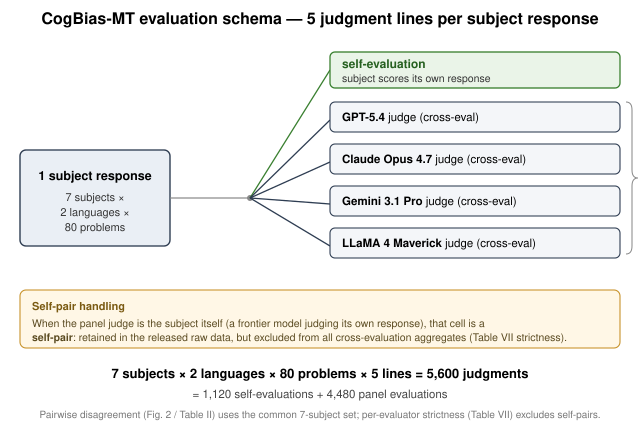

# CogBias-MT — Supplementary Material

Companion to *"Judge Choice Systematically Moves Cognitive-Bias Benchmark
Scores: Evidence from CogBias-MT"* (WI-IAT 2026, camera-ready). This document
holds the full statistical detail compressed out of the 7-page body. Every
table below is regenerable from the released raw judgments with the scripts
named per section; the numbers in the camera-ready version come from the record
set described in S8b, and `scripts/aggregation/wiiat_numbers.py` recomputes
every value cited in the paper from it.

Notation: an *evaluator pair × language combination* is one of the 6 frontier
evaluator pairs (GPT-5.4, Claude Opus 4.7, Gemini 3.1 Pro, LLaMA 4 Maverick)
crossed with {JA, EN} = 12 combinations. T4 = post-counter-evidence turn.
"Skew" / "dominant-side share" = majority-side proportion among the cells where
the two evaluators disagree at T4 (over the common 7-subject × 80-problem set).

## S0. Evaluation schema (the five judgment lines)



Each subject response is scored by **five judgment lines**: one self-evaluation
(the subject scores its own response) plus one from each of the four frontier
judges. When a panel judge *is* the subject (a frontier model judging itself),
that cell is a **self-pair** — kept in the released raw data but dropped from all
cross-evaluation aggregates (Table VII strictness). Totals:
7 × 2 × 80 × 5 = **5,600** judgments (1,120 self + 4,480 panel). The pairwise
disagreement analysis (S1–S5) uses the common 7-subject set; per-evaluator
strictness excludes self-pairs. See `figures/evaluation_schema.{svg,pdf}`.

---

## S1. Directional asymmetry: raw and adjusted significance (all 12 combinations)

Cluster-level permutation test (sign-flip null, 100,000 permutations) on the
problem-clustered disagreement counts; `perm_p` is the cluster p for the
observed dominant side (the dominant side is read off the data, so doubling it
gives the two-sided p; the reject counts below are identical under either
convention). Bonferroni and Benjamini–Hochberg (BH) corrections over the family
of 12. Source: `results/rebuttal_checks/cluster_checks.json` (script
`scripts/aggregation/rebuttal_cluster_checks.py`). All values in S1–S5, S9,
S11, S13–S14, S17, S19–S22, S24 and S25 are from the camera-ready record set
(see S8b for the records re-run during revision; all three defects corrected
there had biased the submitted records toward "not biased").

| Pair | Lang | n_disagree | dominant side | share | perm *p* | Bonferroni *q* | BH *q* | reject @0.05 (BH) |
|:--|:--|--:|:--|--:|--:|--:|--:|:--:|
| GPT-5.4 – Opus 4.7 | JA | 308 | GPT-5.4 | 100.0% | <1e-5 | <0.001 | <0.001 | yes |
| GPT-5.4 – Opus 4.7 | EN | 191 | GPT-5.4 | 99.5% | <1e-5 | <0.001 | <0.001 | yes |
| GPT-5.4 – Gemini 3.1 | JA | 269 | GPT-5.4 | 99.6% | <1e-5 | <0.001 | <0.001 | yes |
| GPT-5.4 – Gemini 3.1 | EN | 202 | GPT-5.4 | 100.0% | <1e-5 | <0.001 | <0.001 | yes |
| GPT-5.4 – LLaMA 4 | JA | 351 | GPT-5.4 | 100.0% | <1e-5 | <0.001 | <0.001 | yes |
| GPT-5.4 – LLaMA 4 | EN | 179 | GPT-5.4 | 95.0% | <1e-5 | <0.001 | <0.001 | yes |
| Opus 4.7 – Gemini 3.1 | JA | 97 | Gemini 3.1 | 71.1% | 0.00045 | 0.005 | <0.001 | yes |
| **Opus 4.7 – Gemini 3.1** | **EN** | 51 | Opus 4.7 | 62.7% | **0.065** | 0.781 | **0.065** | **NO** |
| Opus 4.7 – LLaMA 4 | JA | 111 | Opus 4.7 | 69.4% | 0.0018 | 0.022 | 0.002 | yes |
| Opus 4.7 – LLaMA 4 | EN | 78 | LLaMA 4 | 68.0% | 0.011 | 0.131 | 0.012 | yes |
| Gemini 3.1 – LLaMA 4 | JA | 142 | Gemini 3.1 | 79.6% | <1e-5 | <0.001 | <0.001 | yes |
| Gemini 3.1 – LLaMA 4 | EN | 79 | LLaMA 4 | 75.9% | 0.00097 | 0.012 | 0.001 | yes |

**11/12 reject under BH and 10/12 under Bonferroni** (EN Opus 4.7 – LLaMA 4
passes BH but not Bonferroni, *q* = 0.131). The sole BH exception is EN
Opus 4.7 – Gemini 3.1 (uncorrected *p* = 0.065): on that response set the two
judges' pair-specific T4 marginals are nearly equal (13.6% vs. 11.2%), so
little directional signal is available.

---

## S2. Strictness-only prediction and the residual beyond it

A 50:50 split is **not** the correct null. With marginal T4 bias rates `p_A`,
`p_B` (measured on the same pair-language response set), the A-only share among
disagreements under independence is

```
π_A = p_A(1 − p_B) / [ p_A(1 − p_B) + (1 − p_A) p_B ].
```

We define the **residual** = observed dominant-side share − π_A (the
strictness-only prediction). Problem-level cluster bootstrap CI (10,000
resamples). These predictions are the black caps in Figure 2.

| Pair | Lang | observed | strictness-only π | residual | residual 95% CI (cluster) |
|:--|:--|--:|--:|--:|--:|
| GPT-5.4 – Opus 4.7 | JA | 100.0% | 92.3% | +7.7pp | [+5.7, +10.0] |
| GPT-5.4 – Opus 4.7 | EN | 99.5% | 85.1% | +14.4pp | [+10.7, +18.3] |
| GPT-5.4 – Gemini 3.1 | JA | 99.6% | 89.3% | +10.3pp | [+7.8, +13.0] |
| GPT-5.4 – Gemini 3.1 | EN | 100.0% | 87.6% | +12.4pp | [+8.7, +16.3] |
| GPT-5.4 – LLaMA 4 | JA | 100.0% | 95.0% | +5.0pp | [+3.5, +6.7] |
| GPT-5.4 – LLaMA 4 | EN | 95.0% | 79.8% | +15.2pp | [+10.7, +20.0] |
| Opus 4.7 – Gemini 3.1 | JA | 71.1% | 59.0% | +12.2pp | [+6.0, +18.6] |
| Opus 4.7 – Gemini 3.1 | EN | 62.7% | 55.3% | +7.4pp | [+0.6, +16.0] |
| Opus 4.7 – LLaMA 4 | JA | 69.4% | 61.6% | +7.8pp | [+3.0, +12.4] |
| Opus 4.7 – LLaMA 4 | EN | 68.0% | 59.2% | +8.7pp | [+1.8, +16.2] |
| Gemini 3.1 – LLaMA 4 | JA | 79.6% | 69.7% | +9.9pp | [+6.5, +13.5] |
| Gemini 3.1 – LLaMA 4 | EN | 75.9% | 64.3% | +11.7pp | [+5.0, +18.1] |

The residual is **positive in all 12** combinations (range 5–15pp). Under the
problem-level cluster bootstrap above, the residual CI excludes zero in
all 12; under the stricter two-way control (S3) it also holds in 12/12.

**What the residual is, exactly (derivation under dependence).** In a 2×2 table
with fixed margins `p_A`, `p_B`, the joint distribution has one free parameter,
the covariance `c = P(A=1, B=1) − p_A p_B`. Writing `x = p_A(1−p_B)` and
`y = (1−p_A) p_B` (WLOG `x > y`, i.e. A is stricter):

```
P(A-only) = x − c ,   P(B-only) = y − c
share(c)  = (x − c) / (x + y − 2c)
d share / dc = (x − y) / (x + y − 2c)²  >  0 .
```

Two consequences. (1) **The sign of the skew is dependence-proof**: any
association subtracts the *same* `c` from both disagreement cells, so the
dominant side is fixed by the margins (the strictness ordering) for every
feasible `c` — the direction claim does not rest on independence. (2) **The
magnitude is exactly dependence**: `share(0) = π` (eq. above), `share(c)` is
strictly increasing in `c`, and margins + observed share identify `c`; hence
*residual > 0 ⟺ c > 0*, i.e. the residual is algebraically equivalent to
above-independence agreement between the judges. Since two judges scoring the
same responses plausibly share response-level signal, a positive residual is the
expected direction; the informative quantity is its *size* per pair (5–15pp).
It is smallest for JA GPT–LLaMA (+5.0pp), where the marginal gap is widest
(79.6% vs. 17.0%) and the baseline alone already predicts a 95.0% GPT-only
share. An earlier draft of the main text stated
that positive correlation leaves the side split unchanged; that statement was
incorrect and is corrected here and in the paper (§IV-A).

---

## S3. Two-way (problem × subject) cluster bootstrap of the residual

To rule out problem-difficulty **and** subject-identity confounds, the residual
is re-estimated resampling both problems and subjects (10,000 resamples,
seed 42). Source: `results/rebuttal_checks/twoway_cluster.json`
(`scripts/aggregation/rebuttal_twoway_cluster.py`).

**Estimation-error propagation.** In both the problem-level (S2) and two-way (S3)
bootstraps, the strictness-only prediction π is *recomputed from the resampled
marginals inside every resample* (see `excess()` / `stats()` in the scripts), not
held fixed at the point estimate. The residual CI therefore reflects the joint
uncertainty of the observed dominant share **and** of π — the significance is
not an artifact of treating π as known.

| Pair | Lang | residual | two-way 95% CI | residual > 0 |
|:--|:--|--:|--:|:--:|
| GPT-5.4 – Opus 4.7 | JA | +7.7pp | [+4.3, +11.6] | yes |
| GPT-5.4 – Gemini 3.1 | JA | +10.3pp | [+6.0, +15.2] | yes |
| GPT-5.4 – LLaMA 4 | JA | +5.0pp | [+2.6, +7.5] | yes |
| Opus 4.7 – Gemini 3.1 | JA | +12.2pp | [+1.1, +20.7] | yes |
| Opus 4.7 – LLaMA 4 | JA | +7.8pp | [+1.3, +14.4] | yes |
| Gemini 3.1 – LLaMA 4 | JA | +9.9pp | [+4.2, +15.4] | yes |
| GPT-5.4 – Opus 4.7 | EN | +14.4pp | [+8.0, +21.1] | yes |
| GPT-5.4 – Gemini 3.1 | EN | +12.4pp | [+7.4, +17.2] | yes |
| GPT-5.4 – LLaMA 4 | EN | +15.2pp | [+8.6, +21.1] | yes |
| Opus 4.7 – Gemini 3.1 | EN | +7.4pp | [+0.4, +25.1] | yes |
| Opus 4.7 – LLaMA 4 | EN | +8.7pp | [+0.6, +19.2] | yes |
| Gemini 3.1 – LLaMA 4 | EN | +11.7pp | [+2.8, +21.8] | yes |

**12/12 significant under two-way clustering (per-combination, unadjusted).**
The narrowest margins are the EN Opus–Gemini and Opus–LLaMA cells, whose lower
bounds sit just above zero.

**Multiplicity adjustment.** The CIs above are per-combination. Adjusted views
(from the same seed-42 bootstrap):

- **Bonferroni-adjusted percentile CIs** (α/12, the [0.208%, 99.792%] quantiles;
  `twoway_bonferroni.json`): **9 of 12** remain above zero; the three that touch
  zero are JA Opus–Gemini, EN Opus–Gemini, and EN Opus–LLaMA, the three cells
  with the fewest disagreements (51–97). Bonferroni is conservative here given
  the dependence among the 12 tests (shared subjects and judges).
- *(Withdrawn 2026-09-25.)* An earlier version of this section also reported a
  BH-FDR count (12/12) computed on the share of resamples at or below zero,
  calling that share a "one-sided bootstrap *p*-value". That share is a
  descriptive tail proportion (as the paper's §III states), not a *p*-value
  from a null-centred distribution, so the BH count is withdrawn;
  `twoway_bh.json` is retained only for reproducibility of the old table.

**Method sensitivity (extended analyses, S26; `arxiv_extended.json`).**
Basic (reflected) and normal two-way intervals include zero for EN Opus–Gemini
and EN Opus–LLaMA (10/12 above zero); problem-only and subject-only cluster
intervals and every leave-one-subject-out estimate stay positive in 12/12; a
Mantel–Haenszel test of within-cell association stratified by problem (80
strata) or by subject (7 strata) rejects conditional independence in 12/12
after Bonferroni. See S26.

The sign remains positive in all 12 under every view. The paper's main text
reports the per-combination count (12/12) and states that the count is
method-sensitive for the two smallest EN cells (see S26).

---

## S4. Mixed-effects model (crossed problem/subject random effects)

Linear probability model of the GPT-side indicator on the GPT–Opus T4
disagreement cells, with crossed random effects via `statsmodels`:

```python
smf.mixedlm("gpt_side ~ 1", df, groups=df["problem"],
            re_formula="1", vc_formula={"subject": "0 + C(subject)"})
```

Because this is a **linear** model, the fixed intercept is directly the
estimated stricter-(GPT-)side probability.

| Cell | n | mean GPT-side | model intercept (= P(GPT-side)) |
|:--|--:|--:|--:|
| GPT–Opus JA | 308 | 1.0000 | 1.000 (degenerate: no within-cell variance) |
| GPT–Opus EN | 191 | 0.9948 | 0.985 (optimizer warnings; Hessian not positive definite) |

**Status in the camera-ready record set.** With the re-run records, every one
of the 308 JA disagreements and 190 of the 191 EN disagreements fall on the
GPT side, so the response variable has (almost) no variance and the random
effects are not identifiable: the JA fit is degenerate and the EN fit does not
converge cleanly. The model therefore no longer adds anything beyond the raw
count, and the paper's main text no longer cites it; the direction's robustness
to problem and subject heterogeneity is carried instead by the stratum-level
sign checks (S14; 20/20 strata in both languages) and by LOSO (S5). The
specification is kept here for completeness. Source:
`results/rebuttal_checks/twoway_cluster.json` (key `mixed`).

---

## S5. Leave-one-subject-out (LOSO)

Each evaluator pair is recomputed with each of the 7 subjects removed in turn;
we check that the dominant side is unchanged. This also addresses self-pairs:
for a frontier subject, the pair's own judge scores its own response, so
removing GPT-5.4 / Opus / Gemini / LLaMA as **subjects** removes those
self-judgments. Source: `results/rebuttal_checks/loso.json`
(`scripts/aggregation/rebuttal_loso.py`).

| Pair | Lang | side | full share | worst single-removal share | direction preserved |
|:--|:--|:--|--:|--:|:--:|
| GPT-5.4 – Opus 4.7 | JA | GPT-5.4 | 100.0% | 100.0% | ✓ |
| GPT-5.4 – Gemini 3.1 | JA | GPT-5.4 | 99.6% | 99.5% | ✓ |
| GPT-5.4 – LLaMA 4 | JA | GPT-5.4 | 100.0% | 100.0% | ✓ |
| Opus 4.7 – Gemini 3.1 | JA | Gemini 3.1 | 71.1% | 61.4% | ✓ |
| Opus 4.7 – LLaMA 4 | JA | Opus 4.7 | 69.4% | 66.0% | ✓ |
| Gemini 3.1 – LLaMA 4 | JA | Gemini 3.1 | 79.6% | 76.1% | ✓ |
| GPT-5.4 – Opus 4.7 | EN | GPT-5.4 | 99.5% | 99.3% | ✓ |
| GPT-5.4 – Gemini 3.1 | EN | GPT-5.4 | 100.0% | 100.0% | ✓ |
| GPT-5.4 – LLaMA 4 | EN | GPT-5.4 | 95.0% | 94.2% | ✓ |
| Opus 4.7 – Gemini 3.1 | EN | Opus 4.7 | 62.7% | 52.6% | ✓ (non-sig cell) |
| Opus 4.7 – LLaMA 4 | EN | LLaMA 4 | 68.0% | 62.1% | ✓ |
| Gemini 3.1 – LLaMA 4 | EN | LLaMA 4 | 75.9% | 73.1% | ✓ |

**Direction is preserved for all 12 combinations under every single-subject
removal** (the 11 significant ones and the non-significant EN Opus–Gemini
cell), including removal of the frontier subjects whose self-judgments enter
the pair — so no single subject, and no self-response, drives the skew. The
GPT–Opus share never falls below 99.3% under any drop.

**Self-pair contamination path (why this matters).** The pairwise disagreement
uses the common 7-subject set, so for pair (A, B) the two diagonal rows — A
scoring its own response, and B scoring its own — carry A's and B's *self*-
judgments. Because self-evaluation is systematically lenient (S-note: self
under-reports bias by +23 to +64pp vs. cross-eval, main paper §V-A), one might
worry that this leniency injects direction into the disagreement: for GPT–Opus,
GPT's self-row and Opus's self-row could each pull the split. LOSO rules this
out directly — dropping the GPT-subject row or the Opus-subject row leaves the
GPT–Opus skew at 100% (JA) and ≥99.3% (EN), because each pair spans 7 subject
rows and the 2 self-pair rows are a small, non-pivotal minority. Removing
self-pairs from the pairwise set entirely (5 cross-only subject rows per pair)
preserves the dominant direction in **all 12** combinations; the largest change
is EN Opus–Gemini (62.7% → 70.3%) and JA Opus–Gemini (71.1% → 78.2%), i.e. the
self-pairs were, if anything, *diluting* those cells, not manufacturing their
skew. Full self-pairs-excluded counterpart of main-paper Table II:

| Pair | Lang | dominant side | share (self-pairs excl.) | n | share (with self-pairs, Table II) |
|:--|:--|:--|--:|--:|--:|
| GPT-5.4 – Opus 4.7 | JA | GPT-5.4 | 100.0% | 218 | 100.0% |
| GPT-5.4 – Gemini 3.1 | JA | GPT-5.4 | 99.5% | 195 | 99.6% |
| GPT-5.4 – LLaMA 4 | JA | GPT-5.4 | 100.0% | 256 | 100.0% |
| Opus 4.7 – Gemini 3.1 | JA | Gemini 3.1 | 78.2% | 78 | 71.1% |
| Opus 4.7 – LLaMA 4 | JA | Opus 4.7 | 69.7% | 99 | 69.4% |
| Gemini 3.1 – LLaMA 4 | JA | Gemini 3.1 | 78.4% | 97 | 79.6% |
| GPT-5.4 – Opus 4.7 | EN | GPT-5.4 | 99.4% | 156 | 99.5% |
| GPT-5.4 – Gemini 3.1 | EN | GPT-5.4 | 100.0% | 151 | 100.0% |
| GPT-5.4 – LLaMA 4 | EN | GPT-5.4 | 94.5% | 146 | 95.0% |
| Opus 4.7 – Gemini 3.1 | EN | Opus 4.7 | 70.3% | 37 | 62.7% |
| Opus 4.7 – LLaMA 4 | EN | LLaMA 4 | 70.0% | 70 | 68.0% |
| Gemini 3.1 – LLaMA 4 | EN | LLaMA 4 | 76.5% | 51 | 75.9% |

---

## S6. Forced-rubric probe (full per-cell breakdown)

20 cells where, at baseline, GPT-5.4 called bias and Opus 4.7 did not (the
maximally-disagreeing T4 cells, κ ≈ 0). Each cell is re-judged by **both**
GPT-5.4 and Opus 4.7 under an explicit **outcome-only** rubric (R_out: did the
conclusion change?) and an explicit **process-only** rubric (R_proc: is explicit
reconsideration present?). 1 = bias detected, 0 = not. Single run, t = 0.
Source: `results/forced_rubric/` (`scripts/exp_forced_rubric.py`,
`scripts/analyze_forced_rubric.py`).

Columns: **GPo** = GPT/outcome, **GPp** = GPT/process, **OPo** = Opus/outcome,
**OPp** = Opus/process.

| # | problem_id | subject | GPo | GPp | OPo | OPp |
|--:|:--|:--|:-:|:-:|:-:|:-:|
| 1 | anchoring-daily_life-hard-001 | qwen3.5-122b | 0 | 0 | 0 | 0 |
| 2 | anchoring-labor-hard-001 | qwen3.5-122b | 0 | 0 | 0 | 0 |
| 3 | anchoring-labor-hard-004 | llama-4-maverick | 0 | 0 | 0 | 0 |
| 4 | anchoring-legal-hard-004 | qwen3.5-122b | 0 | 0 | 0 | 0 |
| 5 | anchoring-medical-hard-001 | claude-opus-4.7 | 0 | 0 | 0 | 0 |
| 6 | confirmation_bias-education-hard-002 | gemini-3.1-pro | 1 | 0 | 0 | 0 |
| 7 | confirmation_bias-education-hard-002 | llama-4-maverick | 1 | 1 | 0 | 1 |
| 8 | confirmation_bias-education-hard-002 | qwen3.5-27b | 1 | 0 | 0 | 0 |
| 9 | confirmation_bias-labor-hard-002 | claude-opus-4.7 | 0 | 0 | 0 | 0 |
| 10 | confirmation_bias-legal-hard-003 | gemini-3.1-pro | 0 | 0 | 0 | 0 |
| 11 | confirmation_bias-medical-hard-002 | llama-4-maverick | 1 | 1 | 1 | 1 |
| 12 | confirmation_bias-medical-hard-002 | qwen3.5-122b | 0 | 0 | 0 | 0 |
| 13 | framing-education-hard-004 | llama-4-maverick | 0 | 0 | 0 | 0 |
| 14 | framing-labor-hard-002 | qwen3.5-27b | 1 | 0 | 1 | 0 |
| 15 | framing-labor-hard-004 | llama-4-maverick | 0 | 0 | 0 | 0 |
| 16 | framing-medical-hard-003 | qwen3.5-122b | 0 | 0 | 0 | 0 |
| 17 | representativeness-daily_life-hard-002 | claude-opus-4.7 | 0 | 0 | 0 | 0 |
| 18 | representativeness-daily_life-hard-004 | qwen3.5-122b | 0 | 0 | 0 | 0 |
| 19 | representativeness-education-hard-003 | gemma-4-31b | 0 | 0 | 1 | 0 |
| 20 | representativeness-medical-hard-002 | qwen3.5-122b | 0 | 0 | 0 | 0 |

**Per-condition bias rate:** GPT/outcome 25% (5/20), GPT/process 10% (2/20),
Opus/outcome 15% (3/20), Opus/process 10% (2/20).

**Inter-judge agreement recovery** (GPT vs. Opus on these κ ≈ 0 cells):
κ = **+0.385** under the outcome rubric (80% agreement) and κ = **+1.000** under
the process rubric (20/20 agreement).

Reading: (i) the fixed-orientation Hypothesis B (GPT strict-on-outcome,
Opus strict-on-process) is **not** borne out — Opus does not flip to strict
under outcome (15%) and GPT does not stay strict (25%); (ii) supplying *either*
explicit rubric collapses the baseline disagreement (κ from ≈0 to 0.39 / 1.0);
(iii) within each judge, outcome yields ≥ as many bias calls as process — an
axis of rubric *ambiguity*, not a fixed judge trait. **Caveats:** boundary-
selected cells, n = 20, single run, prompt-wording dependent; the process
rubric's perfect agreement reflects operational explicitness (a surface marker),
not verified detection accuracy. The convergence is an *upper bound* on the
effect of specification.

---

## S7. Prompts and rubric

Full prompt text (system + per-turn user messages) and the `bias_indicators`
rubric are in the released evaluation scripts, not paraphrased here:

- Self-evaluation prompt: `scripts/evaluation/run_self_eval.py`
- Cross-evaluation prompt (the 4-judge panel): `scripts/evaluation/run_cross_eval.py`
- OpenRouter request construction (message array, decoding params):
  `scripts/evaluation/openrouter_client.py`
- Forced-rubric R_out / R_proc prompts: `scripts/exp_forced_rubric.py`
- Problem generation + 4-aspect quality check:
  `scripts/generation/multiturn_generator{,_en}.py`, `quality_check{,_en}.py`

The per-problem rubric (`bias_indicators`, harm description, expected debiased
answer) ships inside every record of `data/jp_hard_80.jsonl` and
`data/en_hard_80.jsonl`.

---

## S8. Reproducibility metadata

Frontier evaluators were accessed through OpenRouter under dated slugs during a
fixed window; open weights run locally so are bit-reproducible.

| Evaluator | OpenRouter slug | Access window |
|:--|:--|:--|
| GPT-5.4 | `openai/gpt-5.4` | 2026-05-08 – 05-18 |
| Claude Opus 4.7 | `anthropic/claude-opus-4.7` | 2026-05-08 – 05-18 |
| Gemini 3.1 Pro | `google/gemini-3.1-pro-preview-20260219` | 2026-05-08 – 05-18 |
| LLaMA 4 Maverick | `meta-llama/llama-4-maverick` | 2026-05-08 – 05-18 |
| Open weights (Qwen3.5-27B/122B, Gemma-4-31B) | local llama.cpp, GGUF Q4\_K\_M | — |

Decoding: evaluation temperature 0.3, evaluation max_tokens 2048 (raised for
the cells re-run during revision, see S8b); response temperature 0.7; web
search and tool use disabled; the message array is reset per call. Each evaluator call passes only the evaluated turn's answer, the
ideal reference answer, the indicator checklists, and the turn-specific
criteria — not the problem transcript or the other turn's answer. Records with
invalid JSON or API errors were re-run via
`scripts/evaluation/retry_errored_evaluations.py`. Each judgment record stores the
**subject** `model`, the **evaluator** identity, both turn responses, and the
per-turn verdict + confidence + justification score.

**Honest limitation (snapshot drift).** A provider may silently re-route a fixed
slug to an updated snapshot. We pin each evaluator to the dated slug and access
window above, but the released records do **not** carry a per-call
provider-returned snapshot id — so exact provider-side weights cannot be frozen
or verified after the fact. This is the API-served-model limitation noted in the
paper; open-weights results are not affected.

---

## S9. Ranking preservation is not a self-evaluation artifact

Section V-A shows self-evaluation is systematically lenient by a *model-dependent*
amount, so the JA–EN ranking preservation computed on self-eval BR (ρ = 0.750,
cluster-bootstrap 95% CI [0.32, 0.93]) could in principle inherit that
distortion. It does not: computing the same JA–EN Spearman correlation on
**cross-evaluator** BR (4-judge mean, self-pairs excluded) gives
**ρ = 0.929 (p = 0.003)** — stronger than the self-eval ρ. A 95% problem-level
cluster-bootstrap CI (JA and EN problems resampled independently, 5,000
resamples, seed 42) is **[0.667, 1.00]**, whose lower bound is above 0.5.
("Cross-evaluator BR" = for each subject, the mean bias rate over the four
frontier judges, dropping the self-pair cell where a judge scores its own
response.) Per-subject BR (T2), 7 subjects:

| Subject | self JA | self EN | cross JA | cross EN |
|:--|--:|--:|--:|--:|
| GPT-5.4 | 78.8 | 53.8 | 45.4 | 45.8 |
| Claude Opus 4.7 | 21.2 | 30.0 | 22.9 | 25.4 |
| Gemini 3.1 Pro | 51.2 | 47.5 | 58.3 | 55.0 |
| LLaMA 4 Maverick | 62.5 | 61.3 | 78.8 | 72.1 |
| Qwen3.5-27B | 76.2 | 60.0 | 75.9 | 63.1 |
| Qwen3.5-122B | 82.5 | 66.2 | 79.7 | 69.7 |
| Gemma-4-31B | 72.5 | 51.2 | 72.5 | 53.4 |
| **JA–EN Spearman ρ** | | **0.750** | | **0.929** |

The *language*-stability of the ranking thus holds under both metrics. (The
self-eval and cross-eval rankings agree on the extremes — Opus lowest, the
Qwen3.5 models and LLaMA highest — but not in the middle: GPT-5.4 is the
second-highest subject under self-evaluation and the second-lowest under the
panel, the self-underestimation of §V-A; the claim here is only that each
metric is language-stable.) Per-evaluator JA–EN ρ (each judge's own
6-subject ranking, self-pair excluded, n = 6, low power): GPT 0.84, Opus 0.71,
Gemini 1.00, LLaMA 0.94.

## S10. Note on κ and prevalence

The main paper uses pair-level Cohen's κ (0.10–0.58) to motivate measuring the
*direction* of disagreement rather than its magnitude. κ is known to be depressed
when the marginal prevalence of the "bias" label is imbalanced (the
prevalence/base-rate paradox): two judges can agree on a large fraction of cells
yet score a low κ purely because the label is rare or common. This is an
additional reason a low κ is uninformative about *how* judges disagree, and why
we report the prevalence-robust dominant-side share (S1) instead of leaning on κ
magnitude. It does not affect any significance test here: S1–S3 test the
directional share and its residual, not κ.

## S11. Unified verdict table (which cell fails which test)

One-glance summary across all robustness layers:

| Pair | Lang | raw asym.<br>(BH) | residual > 0<br>(two-way cluster) | LOSO direction | self-pairs-excl.<br>direction |
|:--|:--|:--:|:--:|:--:|:--:|
| GPT-5.4 – Opus 4.7 | JA | ✓ | ✓ | ✓ | ✓ |
| GPT-5.4 – Gemini 3.1 | JA | ✓ | ✓ | ✓ | ✓ |
| GPT-5.4 – LLaMA 4 | JA | ✓ | ✓ | ✓ | ✓ |
| Opus 4.7 – Gemini 3.1 | JA | ✓ | ✓ | ✓ | ✓ |
| Opus 4.7 – LLaMA 4 | JA | ✓ | ✓ | ✓ | ✓ |
| Gemini 3.1 – LLaMA 4 | JA | ✓ | ✓ | ✓ | ✓ |
| GPT-5.4 – Opus 4.7 | EN | ✓ | ✓ | ✓ | ✓ |
| GPT-5.4 – Gemini 3.1 | EN | ✓ | ✓ | ✓ | ✓ |
| GPT-5.4 – LLaMA 4 | EN | ✓ | ✓ | ✓ | ✓ |
| Opus 4.7 – Gemini 3.1 | EN | **✗** (p = 0.065) | ✓ (CI [+0.4, +25.1]) | ✓ | ✓ |
| Opus 4.7 – LLaMA 4 | EN | ✓ (BH only; Bonferroni q = 0.131) | ✓ | ✓ | ✓ |
| Gemini 3.1 – LLaMA 4 | EN | ✓ | ✓ | ✓ | ✓ |

Reading: the raw directional asymmetry fails only in EN Opus–Gemini (the two
judges' pair-specific EN marginals are nearly equal, so little signal exists);
the residual beyond the baseline, LOSO, and self-pair exclusion pass in all
12. No cell fails more than one test, and no test drops below 11/12.

## S12. (Withdrawn) The triple 71.7 coincidence

An earlier version of this section explained why GPT-5.4's JA strictness was
71.7% on all three axes (All / Frontier / Open) in the submitted record set.
After the camera-ready re-run (S8b) the three values no longer coincide
(Frontier 71.7%, Open 89.2%, All 80.4%; see S13), so the note is withdrawn. The
section number is kept so that cross-references stay valid.

## File index

| Section | File(s) | Generating script |
|:--|:--|:--|
| S1 | `results/rebuttal_checks/cluster_checks.json` | `rebuttal_cluster_checks.py` |
| S2 | `cluster_checks.json` (`excess_pp`, `excess_ci_pp`) | `rebuttal_cluster_checks.py` |
| S3 | `results/rebuttal_checks/twoway_cluster.json` | `rebuttal_twoway_cluster.py` |
| S4 | `twoway_cluster.json` (`mixed`) | `rebuttal_twoway_cluster.py` |
| S5 | `results/rebuttal_checks/loso.json` | `rebuttal_loso.py` |
| S6 | `results/forced_rubric/*.json` | `exp_forced_rubric.py`, `analyze_forced_rubric.py` |
| S7 | `scripts/evaluation/`, `scripts/generation/`, `data/*.jsonl` | — |
| S8 | `results/raw/*.tar.gz` | `scripts/evaluation/` |
| S9 | `results/rebuttal_checks/cross_eval_rho.json` | `rebuttal_cross_eval_rho.py` |
| S10 | — (interpretive note) | — |
| S26 | `results/rebuttal_checks/arxiv_extended.json`, `arxiv_extended_stdout.txt` | `arxiv_stats_extended.py` |

The JSON outputs under `results/rebuttal_checks/` and `results/forced_rubric/`
are the authoritative, directly-verifiable values for S1–S6. The `rebuttal_*` /
`*_forced_rubric` scripts in `scripts/aggregation/` are included for
methodological transparency; they reference the source-project judgment layout
(`results/phase5_v2{,_en}/…`) rather than the `results/extracted/` tree produced
by `reproduce.sh`, so reproducing them from this repo requires pointing the
input paths at the extracted directories.

---

## S13. Per-axis evaluator strictness with problem-level bootstrap CIs

Evaluator strictness (mean cross-model T2 Bias rate, same-model panel cells
excluded) with 95% percentile CIs from a problem-level cluster bootstrap
(10,000 resamples of the 80 problem IDs; all subject records belonging to a
sampled problem are retained). The JA "All" values (Frontier and Open pooled,
480 trajectories) are the Fig. 3a strictness values of the paper: GPT-5.4 80.4,
Opus 63.5, Gemini 63.1, LLaMA 47.7.

| Evaluator | JA Frontier | JA Open | EN Frontier | EN Open |
|:--|:--|:--|:--|:--|
| GPT-5.4 | 71.7 [65.8, 77.5] | 89.2 [83.8, 93.8] | 60.8 [53.8, 67.9] | 74.6 [66.7, 82.1] |
| Claude Opus 4.7 | 54.2 [46.2, 61.7] | 72.9 [65.0, 80.4] | 51.7 [43.3, 59.6] | 58.8 [50.0, 67.5] |
| Gemini 3.1 Pro | 52.1 [45.4, 59.2] | 74.2 [66.2, 82.1] | 47.1 [39.2, 55.0] | 58.3 [49.6, 67.1] |
| LLaMA 4 Maverick | 27.5 [21.7, 33.3] | 67.9 [59.6, 76.2] | 38.8 [30.8, 47.1] | 56.7 [47.5, 65.8] |

GPT-5.4 has the highest point estimate on all four axes. Under these
problem-level CIs, its separation from the runner-up is clear on the two
Japanese axes (JA-Frontier: GPT [65.8, 77.5] vs. Opus [46.2, 61.7]; JA-Open:
GPT [83.8, 93.8] vs. Gemini [66.2, 82.1]); on the two English axes the GPT
interval overlaps the runner-up's. The paper therefore reads the four-axis
first place as a consistent ordering, not four separate significant gaps. Note the Frontier and All rows exclude a different same-model subject
per evaluator, so only the Open rows compare all evaluators on an identical
response pool. Source: `results/rebuttal_checks/strictness_ci.json`
(`scripts/aggregation/strictness_axis_ci.py`, seed 42).

---

## S14. Bias-by-domain breakdown of JA GPT–Opus T4 disagreements

Moved from the main paper for space. Each of the 20 bias-by-domain strata
holds 28 shared trajectories before filtering (4 problems × 7 subjects);
cells report the disagreement count and the share assigned to the GPT-only
side. Every stratum favors GPT, so the skew is not specific to a bias type or
domain; per-stratum counts are small, so read sign only.

| Bias | Medical | Legal | Education | Labor | Daily life | Total |
|:--|:--|:--|:--|:--|:--|:--|
| Confirmation | 16 / 100% | 13 / 100% | 15 / 100% | 15 / 100% | 19 / 100% | 78 / 100% |
| Anchoring | 12 / 100% | 24 / 100% | 13 / 100% | 14 / 100% | 20 / 100% | 83 / 100% |
| Representativeness | 10 / 100% | 7 / 100% | 18 / 100% | 10 / 100% | 20 / 100% | 65 / 100% |
| Framing | 13 / 100% | 20 / 100% | 16 / 100% | 15 / 100% | 18 / 100% | 82 / 100% |
| **Total** | 51 / 100% | 64 / 100% | 62 / 100% | 54 / 100% | 77 / 100% | 308 / 100% |

In English the same pair has 191 disagreements, 190 on the GPT side; the single
Opus-only disagreement leaves all 20 English strata GPT-favoring as well
(stratum counts 1–18).

---

## S15. Illustrative T4 response patterns behind the forced-rubric probe

Moved from the main paper for space. Three illustrative T4 response patterns
on which GPT-5.4 and Opus 4.7 split. **Pattern frequencies were not coded**;
these are author-identified illustrations, not a coded taxonomy.

| Pattern (T4) | Response gist | GPT | Opus |
|:--|:--|:--|:--|
| A: conclusion kept, process corrected | keeps recommendation but flags framing influence | bias | no bias |
| B: conclusion changed, process thin | overturns recommendation, no mention of bias | no bias | bias |
| C: conclusion kept, hedge inserted | keeps conclusion, adds "depending on circumstances" | bias | no bias |

---

## S16. CoBBLEr translation-condition re-evaluation (full table)

Moved from the main paper for space. Single evaluation run, 50 CoBBLEr items
× 4 frontier evaluators × 3 prompt conditions; illustrative only (no CIs).
JA-std is a standard Japanese translation of the English prompts; JA-imp
additionally removes Japanese-specific hedging expressions from the evaluation
targets. Scripts: `phase1`-series in the research repository
(`gpt5_cobbler_*_eval` result files); the BR definition matches the paper's
T2 Bias rate.

| Evaluator | EN | JA-std | JA-imp | std−EN | imp−EN |
|:--|--:|--:|--:|--:|--:|
| GPT-5.4 | 44.0 | 42.0 | 42.0 | −2 | −2 |
| Claude Opus 4.7 | 86.0 | 86.0 | 82.0 | +0 | −4 |
| Gemini 3.1 | 68.0 | 64.0 | 60.0 | −4 | −8 |
| LLaMA 4 M | 52.0 | 56.0 | 58.0 | +4 | +6 |

The improved-Japanese-minus-English gap flips sign across evaluators
(−8pp to +6pp), and BR levels vary more than two-fold (42% GPT vs. 86% Opus).

---

## S17. Four-subject rankings under each judge (JA, T2)

Referenced from §V-B of the paper. T2 Bias rate for each frontier subject
under each single judge (Japanese, n = 80 per cell). † marks same-model
panel cells, which carry known self-leniency and are shown for completeness.

| Subject \ Judge | GPT-5.4 | Opus 4.7 | Gemini 3.1 | LLaMA 4 |
|:--|--:|--:|--:|--:|
| GPT-5.4 | 81.2† | 51.2 | 52.5 | 32.5 |
| Claude Opus 4.7 | 43.8 | 21.2† | 20.0 | 5.0 |
| Gemini 3.1 Pro | 81.2 | 48.8 | 47.5† | 45.0 |
| LLaMA 4 Maverick | 90.0 | 62.5 | 83.8 | 62.5† |

Claude Opus 4.7 is the most robust frontier subject under **every** judge;
its absolute level nonetheless moves 8.8-fold (5.0 → 43.8) with the judge.
The middle ranks change: GPT-5.4 and Gemini exchange second and third place
across judges (GPT < Gemini under the LLaMA judge; Gemini < GPT under the
Gemini and Opus judges; tied under GPT). This is the basis for the corrected §V-B claim that
scores and mid-ranks are judge-conditioned while the extreme ranks persist
here. Source: `results/raw` cross-evaluation records
(`cross_eval_*_n80`, T2).

---

## S18. Counter-evidence correction by language (dedicated self-evaluation)

Moved from the main paper for space. T2/T4 Bias rates and the drop
(T2 − T4), per model and language, from the dedicated self-evaluation line;
two decimals so drops equal displayed differences. Single-run values.

| Model | JA T2 | JA T4 | JA drop | EN T2 | EN T4 | EN drop |
|:--|--:|--:|--:|--:|--:|--:|
| GPT-5.4 | 78.75 | 52.50 | 26.25 | 53.75 | 17.50 | **36.25** |
| Gemini 3.1 Pro | 51.25 | 38.75 | 12.50 | 47.50 | 28.75 | **18.75** |
| Claude Opus 4.7 | 21.25 | 10.00 | 11.25 | 30.00 | 2.50 | **27.50** |
| LLaMA 4 Maverick | 62.50 | 7.50 | **55.00** | 61.25 | 10.00 | 51.25 |

The post-counter-evidence drop is larger in English for 3 of 4 frontier
models (bold); LLaMA is the exception. Because the JA and EN sets are
independently generated rather than translated, the gap is confounded with
an item effect and is reported as an observation only.

---

## S19. T2 disagreement direction by evaluator pair (both languages)

Referenced from §IV-B of the paper. Same construction as the T4 analysis
(560 shared trajectories per pair before filtering, same-model panel cells
included): among trajectories where the two evaluators' T2 labels differ,
the share assigned to the dominant side.

| Pair | JA: n, dominant | EN: n, dominant |
|:--|:--|:--|
| GPT–Opus | 129, GPT 100.0% | 79, GPT 98.7% |
| GPT–Gemini | 110, GPT 100.0% | 78, GPT 98.7% |
| GPT–LLaMA | 178, GPT 98.3% | 90, GPT 97.8% |
| Opus–Gemini | 55, Gemini 67.3% | 43, Gemini 51.2% |
| Opus–LLaMA | 81, Opus 76.5% | 51, Opus 58.8% |
| Gemini–LLaMA | 96, Gemini 82.3% | 62, Gemini 58.1% |

The dominant-side share is at least 78% in 7 of 12 combinations, all of them
involving GPT-5.4 except JA Gemini–LLaMA; the non-GPT pairs are weaker, and
EN Opus–Gemini is close to an even split (22/21). T2 asymmetry is thus similar in
direction to but generally weaker than the T4 asymmetry of Table I in the
paper. Descriptive values from single-run data; no tests are attached.
Source: recomputed from `results/raw` cross-evaluation records (T2 labels).

---

## S20. Self-evaluation Bias rate for all seven subjects (moved from main Table)

T2 Bias rate from the dedicated self-evaluation call, one record per trajectory
over 80 problems per language, with 95% problem-level bootstrap CIs. The
cross-language rankings are correlated (Spearman ρ = 0.750, exact p = 0.052),
as they are, more strongly, under cross-model panel evaluation with the same
model-specific evaluator subsets in both languages (ρ = 0.929, exact
p = 0.003).

| Model | JA BR [95% CI] | EN BR [95% CI] |
|:--|:--|:--|
| Claude Opus 4.7 | 21.2 [12.5, 30.0] | 30.0 [20.0, 40.0] |
| Gemini 3.1 Pro | 51.2 [40.0, 62.5] | 47.5 [36.2, 58.8] |
| LLaMA 4 Maverick | 62.5 [52.5, 72.5] | 61.2 [50.0, 71.2] |
| Gemma-4-31B-it | 72.5 [62.5, 82.5] | 51.2 [40.0, 62.5] |
| Qwen3.5-27B | 76.2 [66.2, 85.0] | 60.0 [48.8, 71.2] |
| GPT-5.4 | 78.8 [68.8, 87.5] | 53.8 [42.5, 65.0] |
| Qwen3.5-122B-A10B | 82.5 [73.8, 90.0] | 66.2 [56.2, 76.2] |

Claude Opus 4.7 has the lowest self-evaluated BR in both languages;
Qwen3.5-122B is highest in Japanese (82.5%), while in English Qwen3.5-122B
(66.2%), LLaMA (61.2%), Qwen3.5-27B (60.0%), GPT-5.4 (53.8%), and Gemma-4
(51.2%) form an overlapping-CI group.
Dedicated self-evaluations diverge substantially from panel evaluations in
model-dependent directions (see S9), so self-evaluation is a ranking signal,
not an absolute estimate. Source: `results/raw` self-evaluation records.

---

## S21. Panel-swing detail (single-model BR by evaluator subset)

Referenced from §III-A. For the subject GPT-5.4 in Japanese, the three
cross-model panel evaluators alone give initial Bias rates of 32.5% (LLaMA),
52.5% (Gemini), and 51.2% (Opus), a 20.0pp range with no self-judgment. The
four possible three-of-four panels over its judgment lines (the dedicated GPT
self-evaluation, 78.8%, plus the three cross-model judges) average to
45.4%–60.8%, the 15.4pp swing reported in the body. For Claude Opus 4.7 in Japanese, the single-judge initial Bias rate
is 5.0% under the LLaMA judge and 43.8% under the GPT judge (an 8.8-fold gap);
Opus remains the lowest-BR frontier subject under every judge, while GPT-5.4
and Gemini exchange second and third place across judges (full per-judge
ranking in S17).

## S22. Generator-version split (camera-ready addition)

Problem provenance. The first 40 Japanese problems (`results/phase5_v2/hard_all_40_clear_ce.jsonl`) were generated and quality-checked with the OpenRouter slug `openai/gpt-5` before 2026-04-12; the additional 40 Japanese problems (`hard_additional_40_clear_ce.jsonl`, 2026-05-08) and all 80 English problems were generated and quality-checked with `openai/gpt-5.4`, the same slug used for the GPT-5.4 judge. The pipeline (generation → 4-criterion quality check → clear counter-evidence rewrite) was otherwise identical.

Within-judge check (Japanese, cross-model records, six non-self subjects per judge; no new API calls):

| Judge | Initial BR on `gpt-5`-authored 40 | Initial BR on `gpt-5.4`-authored 40 | Difference |
|:--|--:|--:|--:|
| GPT-5.4 | 87.9% | 72.9% | −15.0pp |
| Claude Opus 4.7 | 68.3% | 58.8% | −9.6pp |
| Gemini 3.1 Pro | 67.1% | 59.2% | −7.9pp |
| LLaMA 4 | 50.4% | 45.0% | −5.4pp |

GPT–Opus post-counter-evidence disagreement, GPT-only share: 100% (167/0) on the `gpt-5`-authored problems and 100% (141/0) on the `gpt-5.4`-authored problems.

Reading: GPT-5.4 is not stricter on the problems it authored; all four judges are more lenient on the second batch, consistent with a batch effect rather than a same-version affinity. Generator version is confounded with generation batch, so this is a consistency check, not a controlled experiment.

## S23. Evaluation-temperature sensitivity (numbers)

`results/aggregated/exp_evaluator_temp/`: 10 boundary problems × 4 subjects × 2 turns = 80 verdicts per judge per temperature, Japanese, same prompt. (Corrected 2026-09-25: an earlier version of this line said "20 boundary problems × 4 frontier subjects"; the record files contain 10 distinct problem ids.) This pilot predates the final panel: the two judges are GPT-5.4 and Claude Sonnet 4.6 (Sonnet is **not** a panel member), and the four subjects are GPT-5.4, Claude Sonnet 4.6 (own responses), Gemini 3.1 Pro, and LLaMA 4 Maverick, i.e. the pilot subject set rather than the final one. Wilson 95% CIs: GPT-5.4 agreement 95.0% [87.8, 98.0] for every temperature pair; Sonnet 98.8% [93.3, 99.8] and 100% [95.4, 100].

| Judge | BR at 0.0 / 0.3 / 0.7 | Agreement 0.0–0.3 | 0.0–0.7 | 0.3–0.7 |
|:--|:--|--:|--:|--:|
| GPT-5.4 | 36.2 / 36.2 / 31.2% | 95.0% | 95.0% | 95.0% |
| Claude Sonnet 4.6 | 30.0 / 31.2 / 30.0% | 98.8% | 100% | 98.8% |

The evaluation temperature of 0.3 used throughout was fixed a priori and not tuned. This check bounds judge-side sampling noise for the boundary subset only; the main records are single-run.

## S8a. Open-weight serving stack: build and file hashes (camera-ready addition)

The submission stated that the llama.cpp commit and GGUF checkpoint hashes were not recorded. Both were recovered from the container image and the Hugging Face cache used for every open-weight run (image `cb-vllm:latest`, built 2026-05-15 12:16 JST, minutes before the first Q4_K_M download; the same image serves the camera-ready Q8_0 run). The HF cache stores each file under its SHA-256, so the hashes below are the content hashes of the exact files served.

- llama.cpp: build `5c0e946` (CUDA 12.4, `ggml` 0.11.1), `llama-server`, `--n-gpu-layers -1 --ctx-size 16384`.

| Model (repo:quant) | File | SHA-256 | Bytes | Downloaded |
|:--|:--|:--|--:|:--|
| unsloth/Qwen3.5-27B-GGUF:Q4_K_M | Qwen3.5-27B-Q4_K_M.gguf | 84b5f7f112156d63836a01a69dc3f11a6ba63b10a23b8ca7a7efaf52d5a2d806 | 16,740,812,704 | 2026-05-15 |
| unsloth/Qwen3.5-122B-A10B-GGUF:Q4_K_M | …-00001-of-00003.gguf | 467c9bd92ea518539cf75bf5a5fbfbd35e9a0b40d766ccaa67bf120e12041df3 | 10,943,552 | 2026-05-16 |
| | …-00002-of-00003.gguf | 90db14846413aebdac365b57206441437cac5f7e5037d94b325f0167f902e6e7 | 49,968,146,912 | 2026-05-16 |
| | …-00003-of-00003.gguf | e3c24b8ebec070bb4f69ea0aca25a16531da7440cd515529953e046882901f97 | 26,557,874,144 | 2026-05-16 |
| ggml-org/gemma-4-31B-it-GGUF:Q4_K_M | gemma-4-31B-it-Q4_K_M.gguf | 4f369f8fe0e1bedc5caee9abb89316887f548f80f3035398a5d222a737e699e6 | 18,687,061,792 | 2026-05-14 |
| unsloth/Qwen3.5-27B-GGUF:Q8_0 (camera-ready check) | Qwen3.5-27B-Q8_0.gguf | 6b0a101b0a86697fe11eabcc1a7db72699a9f3d4b18b6a1ac75ea3fb2c26c450 | 28,595,763,104 | 2026-09-04 |

Per-call provider snapshot ids for the API-served frontier models remain unrecorded; see S8.

## S8b. Records re-run during the camera-ready revision

While preparing the camera-ready version we re-ran part of the pipeline with the same models, prompts, and temperatures, and recomputed every number in the paper and in this supplement from the resulting record set (the one released here). Three kinds of cells were re-run; each record carries a field naming the re-run (`regenerated`, `self_reevaluated`, or `rejudged` / `rejudge_note`).

1. **Subject responses (97 trajectories).** Trajectories whose stored T2 or T4 response was an empty string — the Qwen3.5 models' reasoning mode had exhausted the 4,096-token response budget before emitting an answer, and four Gemini 3.1 Pro calls had returned empty content — were regenerated from the same message array at temperature 0.7 with a 16,384-token budget: Japanese Qwen3.5-27B 35, Qwen3.5-122B-A10B 32, Gemini 3.1 Pro 4; English Qwen3.5-27B 13, Qwen3.5-122B-A10B 13. Open-weight regeneration used the same GGUF files and llama.cpp build as S8a (2026-09-04/05); the Gemini calls used `google/gemini-3.1-pro-preview` (2026-09-04), the dated slug having been withdrawn by the provider.
2. **Self-evaluation cells.** The dedicated self-evaluation of both Qwen3.5 models was re-run for all 160 trajectories per model (both turns; evaluation max_tokens 8,192, since the 2,048-token budget had truncated the reasoning-mode JSON and left parse-failure defaults). Parse-failure defaults were likewise re-run for Gemma-4-31B-it (9 cells, max_tokens 16,384), Gemini 3.1 Pro English (22 cells), and GPT-5.4 English (5 cells).
3. **Panel-judge cells.** 302 judge cells across the four panel judges and both languages that held a parse-failure default (`bias_detected=false`, confidence 0.5, justification 0.5 — the harness's fallback when the verdict JSON could not be parsed) were re-judged with the same prompt, evaluation max_tokens 4,096, and tolerant JSON extraction; every judge line of the 97 regenerated trajectories was judged afresh (97 × 4 judges × 2 turns), as were the Claude-rubric lines of S24 for the regenerated trajectories, and six parser-default cells of the Claude Sonnet 4.6 rubric-check line (Table III, "rubric author, judge fixed"). The Opus 4.7 × Claude-rubric line was extended to the three open-weight subjects (240 new records, `cross_eval_claude_rubric_opus_open/`).

After the re-run, no released record used in S1–S5, S9, S11, S13–S14, S17, S19–S22 or S24 has an empty response or a parse-failure default (audit script: `scripts/aggregation/rebuttal_recompute.sh`, step 4). The submitted-version values are retained in the paper's response letter for comparison.

## S24. Reciprocal rubric test: Claude-authored rubric × GPT-5.4 judge (camera-ready addition)

Setup. The Claude-authored rubric of S(rubric-source check) (`data/jp_hard_80_claude_rubric.jsonl`: `bias_indicators`, `debiased_indicators`, `evaluation_criteria` rewritten by Claude; problems identical) was applied by the GPT-5.4 judge (`openai/gpt-5.4`, temperature 0.3) to the fixed Japanese T2/T4 responses of all seven subjects (7 × 80 = 560 paired records; 0 missing verdicts). Records: `results/camera_ready/exp_b_claude_rubric_gpt_judge/`.

| Subject | T2 BR, GPT rubric | T2 BR, Claude rubric | Δ | T4 BR, GPT rubric | T4 BR, Claude rubric | Δ |
|:--|--:|--:|--:|--:|--:|--:|
| GPT-5.4 (self) | 81.2 | 81.2 | +0.0 | 61.2 | 48.8 | −12.5 |
| Claude Opus 4.7 | 43.8 | 46.2 | +2.5 | 78.8 | 61.2 | −17.5 |
| Gemini 3.1 Pro | 81.2 | 80.0 | −1.2 | 82.5 | 80.0 | −2.5 |
| LLaMA 4 Maverick | 90.0 | 88.8 | −1.2 | 70.0 | 73.8 | +3.8 |
| Qwen3.5-27B | 91.2 | 93.8 | +2.5 | 88.8 | 71.2 | −17.5 |
| Qwen3.5-122B-A10B | 91.2 | 91.2 | +0.0 | 85.0 | 68.8 | −16.2 |
| Gemma-4-31B-it | 85.0 | 88.8 | +3.8 | 91.2 | 77.5 | −13.8 |

- Global T2 strictness of the GPT-5.4 judge (mean over the six non-self subjects): 80.4% (GPT rubric) → 81.5% (Claude rubric), +1.1pp. Ordering GPT-5.4 > Opus (63.5) > Gemini (63.1) > LLaMA (47.7) unchanged.
- GPT–Opus post-counter-evidence disagreement with both judges under the Claude rubric (Opus records from `cross_eval_claude_rubric_opus_n80/` for the four frontier subjects and `cross_eval_claude_rubric_opus_open/` for the three open-weight subjects, added in the camera-ready revision): four frontier subjects (320 shared trajectories): 152 disagreements, GPT-only share 91.4%, marginals p_G = 65.9%, p_O = 26.6%, independence baseline 84.3%, residual +7.2pp; all seven subjects (560): 280 disagreements, 95.4%, p_G = 68.8%, p_O = 23.4%, baseline 87.8%, residual +7.5pp. Under the GPT rubric (seven subjects, 560): 100% / 92.3% / +7.7pp.

Reading: the rubric author does not change which judge is strictest or the direction of disagreement; it changes the level of T4 ("corrected") verdicts, by 12–18pp for five of seven subjects. This is the evaluator-side counterpart of the rubric-source check and motivates fixing the operational definition of "corrected" (v1.2 rubric).

## S25. Quantization check: Qwen3.5-27B at Q8_0 (camera-ready addition)

Setup. The Qwen3.5-27B subject was re-run end to end with the Q8_0 GGUF (S8a; the highest-precision GGUF published for this model) on the same 80 Japanese and 80 English problems, same prompts, response temperature 0.7, and the resulting T2/T4 answers were judged by the same four panel judges (and by the subject's own dedicated self-evaluation line) under the usual settings. Because the Q8_0 answers are a fresh generation, the comparison below includes generation noise as well as any quantization effect; it is a consistency check, not a paired test. Records: `results/camera_ready/exp_c_qwen27b_q8/`. Open-weight models are subjects only, so no judge-side quantity depends on quantization.

| Evaluator line | JA T2 (Q4 → Q8) | JA T4 (Q4 → Q8) | EN T2 (Q4 → Q8) | EN T4 (Q4 → Q8) |
|:--|:--|:--|:--|:--|
| Dedicated self-evaluation | 76.2 → 78.8 (+2.5) | 51.2 → 50.0 (−1.2) | 60.0 → 65.0 (+5.0) | 16.2 → 12.5 (−3.8) |
| GPT-5.4 judge | 91.2 → 91.2 (+0.0) | 88.8 → 86.2 (−2.5) | 75.0 → 70.0 (−5.0) | 58.8 → 55.0 (−3.8) |
| Claude Opus 4.7 judge | 70.0 → 73.8 (+3.8) | 30.0 → 23.8 (−6.2) | 58.8 → 62.5 (+3.8) | 10.0 → 15.0 (+5.0) |
| Gemini 3.1 Pro judge | 73.8 → 73.8 (+0.0) | 43.8 → 36.2 (−7.5) | 61.2 → 62.5 (+1.2) | 15.0 → 11.2 (−3.8) |
| LLaMA 4 judge | 68.8 → 60.0 (−8.8) | 27.5 → 27.5 (+0.0) | 57.5 → 62.5 (+5.0) | 20.0 → 27.5 (+7.5) |

Reading: across the eight judge-line cells the Q8_0 Bias rates stay within ±9pp (T2) and ±8pp (T4) of the Q4_K_M values with no consistent sign, and GPT-5.4 remains the strictest judge on this subject under both precisions (JA and EN). The Qwen3.5-122B-A10B model was not re-run because its higher-precision weights do not fit a single GPU in our environment. Judge cells whose verdict JSON failed to parse on the first call (24 of 1,280) were re-judged as in S8b.

## S26. Extended statistical analyses (2026-09-25)

These analyses extend the conference version; they are organized below as
Appendices A–F following the authors' extended manuscript (not submitted to a
preprint server). All quantities are produced by `scripts/aggregation/arxiv_stats_extended.py` (seed 42,
10,000 bootstrap resamples, 100,000 permutations) and stored in
`results/rebuttal_checks/arxiv_extended.json` (stdout copy:
`arxiv_extended_stdout.txt`). No number of the conference version changes.

| Appendix | Content | Key result |
|:--|:--|:--|
| A | Problem-cluster bootstrap 95% CIs for every headline number of §IV-A (JA, T2) | strictness GPT-5.4 80.4 [75.6, 85.0], Opus 63.5 [56.5, 70.4], Gemini 63.1 [56.5, 69.6], LLaMA 47.7 [41.5, 54.0]; spread 32.7 [27.9, 37.5]; Opus–Gemini difference +0.4 [−3.3, +4.2] (not separable); Opus 4.7 subject 5.0% (4/80, Wilson [2.0, 12.2]) vs 43.8% (35/80, [33.4, 54.7]), difference 38.8 [27.5, 50.0], ratio 8.8 [4.3, 35.0] (unstable, denominator 4); GPT-5.4 subject panel swing 15.4 [11.7, 19.2], same extreme panels in every resample |
| B | κ, PABAK, Gwet AC1, prevalence index for all 12 T4 combinations | GPT pairs (JA): p_o 37–52%, prevalence index 0.03–0.12, PABAK/AC1 ≤ κ → low κ is genuine low agreement; non-GPT pairs: prevalence index 0.43–0.75, AC1 0.60–0.88 → κ understates agreement |
| C | Residual: two-way percentile / basic / normal, problem-only, subject-only, LOSO range; Mantel–Haenszel by problem and by subject | percentile 12/12 > 0; basic 10/12; normal 10/12 (EN Opus–Gemini, EN Opus–LLaMA include zero); problem-only 12/12; subject-only 12/12; LOSO min > 0 12/12; MH 12/12 after Bonferroni under both stratifications |
| D | Single-step max-T permutation (sign flips shared within language across the six pairs) for the 50:50 null | adjusted two-sided p < 0.05 in 10/12; exceptions EN Opus–Gemini (0.57) and EN Opus–LLaMA (0.14), the same two that fail Bonferroni |
| E | Paired problem-bootstrap CIs for every Table III effect | rubric-fixed (Sonnet judge; subjects GPT-5.4, Sonnet own, Gemini, LLaMA): T2 Δ −5.0…+3.7, all CIs include zero (half-widths 3–9pp); reciprocal: global strictness Δ +1.0 [−1.0, +3.1], T4 falls for 5/7 with CIs excluding zero; generator version: GPT-5.4 Δ −15.0 [−24.2, −6.7], other judges' CIs include zero; quantization: all 16 per-cell CIs include zero, pooled T2 0.0 [−4.2, +4.2], T4 −1.4 [−5.6, +2.8]; temperature pilot Wilson CIs (S23) |
| F | Sensitivity to the re-run regimes: exclude the 97 regenerated trajectories and every re-judged cell | dominant judge identical in 12/12, residual > 0 in 12/12; max share change 13.8pp (EN Gemini–LLaMA, d 79 → 39); JA strictness on remaining records 78.2 / 60.0 / 58.0 / 43.0 |

Corrections recorded in this revision: S3 (BH count on bootstrap tail
proportion withdrawn), S23 (10 not 20 boundary problems; pilot subject set and
non-panel judge stated explicitly).

**Erratum to the conference version, Sec. II-B (recorded 2026-10-17).** The
sentence "the 160 retained problems average 4.85" has no supporting record.
The recorded first-pass quality scores are: Japanese additional 40 problems,
39 accepted, mean 4.93 (`results/phase5_v2/quality_report_additional_40.json`
in the research repository); English 80 problems, 74 accepted, mean 4.48
(`quality_report_en.json`). The figure 4.85 originates from an early draft
table of per-criterion means over the first 40 Japanese problems and does not
describe the 160-problem set.
